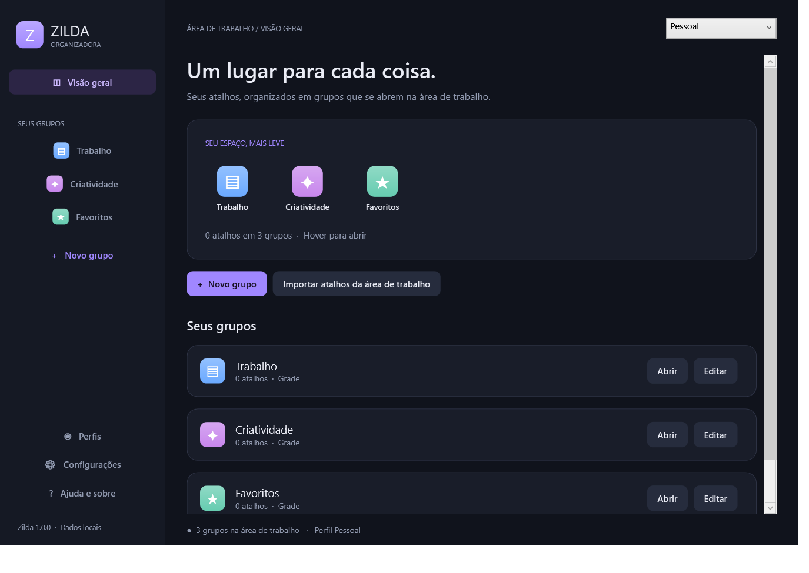

# Zilda Organizadora

**Um lugar para cada coisa.** Organize aplicativos, arquivos, pastas e links em grupos expansíveis na sua área de trabalho do Windows.

Aplicativo nativo em **português**, desenvolvido em C#/WPF, com dados locais, sem conta, sem assinatura e sem conexão obrigatória.



## Instalar

1. Baixe o [instalador](downloads/Zilda-Organizadora-Instalar.exe).
2. Execute o arquivo e clique em **Instalar Zilda**.
3. Escolha um grupo, adicione seus atalhos e personalize o estilo.

Prefere usar sem instalação? Baixe a [versão portátil](downloads/Zilda-Organizadora-Portatil.zip), extraia os arquivos e execute `ZildaOrganizadora.exe`.

**Requisitos:** Windows 10/11 de 64 bits e .NET Framework 4.8. O instalador verifica o Framework, não baixa dependências e instala somente para o usuário atual, sem administrador. Os executáveis desta versão não possuem assinatura digital de publicador.

## Recursos

- **Cinco layouts:** Grade, Coluna, Linha, Leque e Anel, com paginação para grupos grandes.
- **Hover ou clique:** escolha como abrir e ajuste os tempos de abertura, fechamento e animação.
- **Grupos personalizados:** nome, cor, símbolo, ícone e posição na área de trabalho.
- **Atalhos variados:** aplicativos, documentos, pastas, links e arquivos `.lnk`/`.url`, com arrastar e soltar e importação pelo gerenciador.
- **Organização:** pesquisa, renomeação, reordenação, localização do destino e devolução de atalhos ao desktop.
- **Perfis:** crie, duplique e alterne configurações de trabalho, casa ou apresentações.
- **Backup em ZIP:** exporte e restaure perfis, cópias de atalhos, ícones importados e originais arquivados.
- **Integração Windows:** ícone na bandeja, instância única, inicialização opcional e desinstalador.

## Primeiro uso

O aplicativo começa com três grupos vazios: **Trabalho**, **Criatividade** e **Favoritos**. Selecione um grupo no gerenciador para adicionar arquivos, pastas ou links. Passe o mouse sobre seu ícone na área de trabalho para expandi-lo e clique em um atalho para abrir o destino.

Arraste o grupo para mudar sua posição e use o botão direito para editar suas opções. Para abrir o gerenciador, dê dois cliques no ícone da Zilda perto do relógio; ele pode estar no menu `^`. O atalho `Ctrl + Alt + Z` também funciona quando disponível.

Fechar o gerenciador mantém os grupos ativos. Para encerrar o aplicativo, use **Sair da Zilda** no menu da bandeja.

## Seus arquivos permanecem sob seu controle

Por padrão, os originais ficam no lugar. A Zilda mantém cópias privadas de `.lnk` e `.url`; documentos, aplicativos e pastas são referenciados no local original. Se um destino for movido, adicione-o novamente.

O arquivamento de atalhos do desktop é **opcional**. Quando ativado, vale somente para `.lnk`/`.url` arrastados da área de trabalho pessoal. Ao remover a entrada, grupo ou perfil, os originais arquivados são devolvidos sem sobrescrever arquivos existentes. A desinstalação tenta restaurá-los antes de remover o programa e interrompe a remoção se ainda restarem originais arquivados.

Arrastar do painel para o Explorer faz uma cópia. Para retirar uma entrada do grupo e devolver o original, use **Devolver à área de trabalho**.

Dados e logs ficam em `%APPDATA%\ZildaOrganizadora`. A instalação padrão fica em `%LOCALAPPDATA%\Programs\ZildaOrganizadora`. O ZIP portátil também usa a pasta de dados do usuário. Não há telemetria nem atualização automática.

## Compilar

O projeto utiliza o compilador do .NET Framework presente no Windows, sem NuGet ou npm. Na raiz do repositório, execute:

```powershell
powershell -NoProfile -ExecutionPolicy Bypass -File .\src\build.ps1
```

O aplicativo será gerado em `build/ZildaOrganizadora.exe`.

Para gerar o instalador e o ZIP portátil:

```powershell
powershell -NoProfile -ExecutionPolicy Bypass -File .\src\package.ps1
```

Os pacotes serão criados em `outputs/`.

## Testar

```powershell
# Persistência, atalhos, backups, recuperação e layouts
powershell -NoProfile -ExecutionPolicy Bypass -File .\src\verify.ps1

# Inclui navegação, capturas dos cinco painéis e abertura pelo Shell
powershell -NoProfile -ExecutionPolicy Bypass -File .\src\verify.ps1 -Interface
```

Os testes usam pastas isoladas e um desktop simulado para operações de arquivos. A opção `-Interface` abre temporariamente a interface e lança um pequeno executável de prova criado pelo teste. Não abre documentos ou aplicativos do usuário.

Na validação inicial, **23 testes automatizados de dados e layouts passaram**. Foram verificadas também interface, abertura pelo Shell, comunicação entre instâncias, troca de perfil, instalação e desinstalação isoladas. Veja os resultados e o alcance em [Validação](docs/VALIDACAO.md).

## Linha de comando

```text
ZildaOrganizadora.exe --tray
ZildaOrganizadora.exe --profile "Nome do perfil"
ZildaOrganizadora.exe --quit
ZildaOrganizadora.exe --restore-archives --quit
```

Os modos de desenvolvimento `--smoke` e `--self-test` devem ser usados com `--data-dir` apontando para uma pasta exclusiva de teste. O modo smoke adiciona atalhos fictícios à configuração indicada.

## Limitações conhecidas

- O alinhamento usa uma grade própria de 96 pixels; não desloca ícones nativos do Windows.
- O tamanho dos ícones é configurável e não acompanha automaticamente o Ctrl + scroll do desktop.
- O tema escolhido se aplica aos painéis. O gerenciador mantém aparência escura.
- A anexação ao Explorer foi bloqueada com erro Win32 5 no ambiente isolado de validação; foi utilizado o modo alternativo de ordem de janelas.
- Win + D, reinício do Explorer, DPI misto, versões diferentes do Windows e substitutos do Explorer ainda precisam de validação mais ampla.
- O registro real no menu Iniciar, em Apps e na inicialização foi implementado; os testes de instalação usaram um modo isolado para preservar as configurações do usuário.
- A equivalência integral ao DeskRipple não foi estabelecida.

## Estrutura

| Caminho | Conteúdo |
|---|---|
| `src/Models.cs` | Estado, atalhos, restauração e backups |
| `src/Native.cs` | Integração com APIs do Windows |
| `src/Visuals.cs` | Grupos, painéis e cinco layouts |
| `src/Manager.cs` | Interface do gerenciador |
| `src/App.cs` | Inicialização, bandeja e instância única |
| `src/Installer.cs` | Instalador e desinstalador |
| `src/SelfTests.cs` | Testes de dados e layouts |
| `docs/` | Guia, investigação, validação e prévia |
| `downloads/` | Instalador e versão portátil da versão inicial |

## Documentação e origem

- [Guia de uso](docs/GUIA.md)
- [Validação e limites dos testes](docs/VALIDACAO.md)
- [Investigação com TinyFish e REA](docs/INVESTIGACAO.md)

Reconstrução independente inspirada nas funcionalidades públicas do [DeskRipple](https://deskripple.com/). A investigação usou TinyFish para a demonstração web e REA para metadados estáticos do pacote. O executável nativo original não foi executado. Este repositório não inclui código, binários, imagens, licenças ou serviços proprietários do produto original.

## Licença

Consulte [LICENSE](LICENSE) para as permissões de uso, modificação e distribuição do código da Zilda. A licença não concede direitos sobre o DeskRipple nem sobre ícones de aplicativos consultados no próprio Windows.
